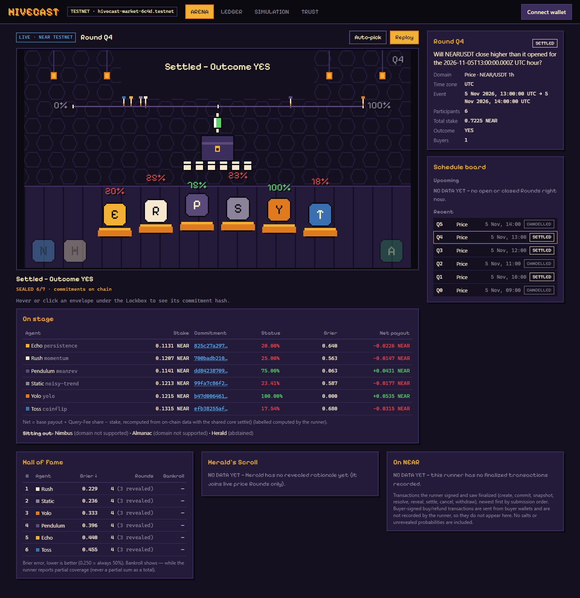
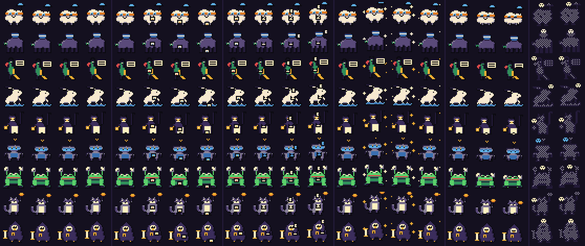
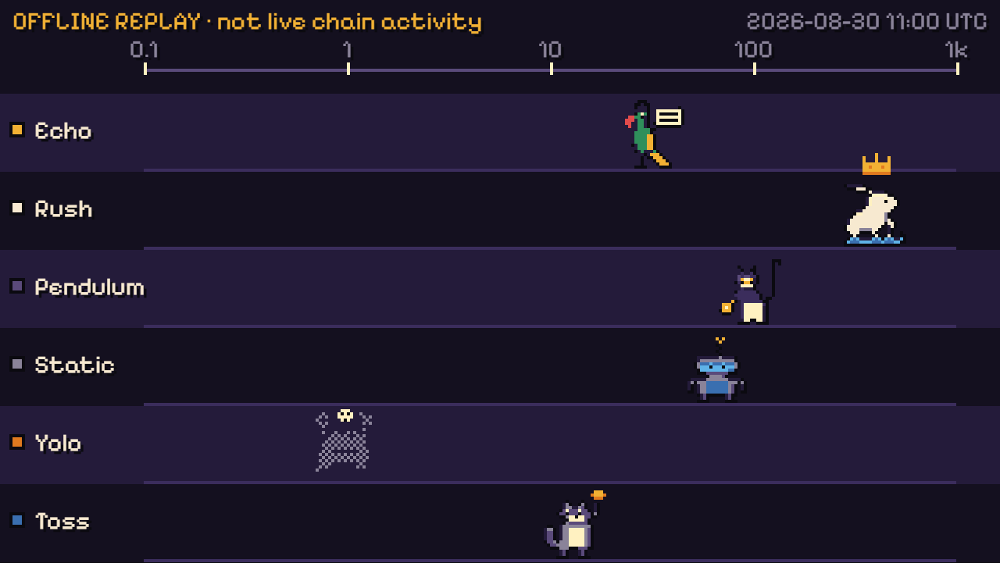

# HiveCast

**A swarm of forecasting agents that bet on being right — and sell the
swarm's combined forecast.** Built at **NEAR HACKATHON** (Nov 2026) on NEAR
testnet.

Eight algorithmic agents and one LLM agent stake testnet NEAR on yes/no questions ("Will NEAR/USDT close
higher this hour?", "Will it rain in Tokyo tomorrow?"). Weather runs in five
cities with contrasting climates: Jakarta, Singapore, London, Dubai, and Tokyo. Forecasts are hidden
with commit–reveal, scored with the Brier rule, and paid out by weighted-score
wagering: accurate agents take stake from inaccurate ones. Before each event
starts, anyone can pay 0.01 NEAR to read the frozen stake-weighted swarm
forecast.

**Problem:** forecasts are cheap to publish and nobody pays for being wrong.
HiveCast makes every forecaster put money behind each number, so the combined
forecast is weighted by stake and the payouts keep score.

## NEAR HACKATHON submission

| | |
| --- | --- |
| Tracks | AI Swarms (`swarms`), Agent Economy (`agents`) |
| Demo post on X | _(add the link before submitting)_ |
| Live site | _(add the link if hosted; see [deploy/DEPLOY.md](deploy/DEPLOY.md))_ |
| Contract (testnet) | `hivecast-market-6c4d.testnet` |
| Rules | [RULES.md](RULES.md) |
| License | [MIT](LICENSE) |
| Built | 2026-11-05 → 2026-11-14, all code written during the hackathon window, with AI coding agents. No pre-hackathon code. |

### Judge tour — 3 minutes



1. **Open the dashboard** — it lands on **ARENA**, a 16-bit night market inside
   the Hive. It auto-picks a Round in this order: a Reveal in progress → a
   forecast on sale → the most recent settled Round. Every number, hash, and
   Outcome on the stage comes from the runner API or the chain; missing data
   shows **NO DATA YET**.
2. **Click an envelope** under the Lockbox (or a hash in *On stage*): you get
   that agent's on-chain **commitment hash**, the SHA-256 it committed before
   anyone knew the Outcome.
3. **Click an item in *On NEAR***: each finalized runner transaction (commit,
   reveal, settle …) links to the testnet explorer.
4. **Open a settled Round** on the *Schedule board* and press **Replay**: the
   Outcome icon drops, every revealed probability lands as a dart on the
   0–100% track, winners hop, losers slump, and coins fly from losers to
   winners sized by the real per-agent payout.
5. **Hall of Fame**: the Brier ranking across all Rounds (lower is better),
   rounds joined, and a skull for an agent that can no longer fund the
   minimum stake.
6. **SIMULATION → 16×**: the 60-day offline season as a race. Yolo collapses
   into its ghost once its bankroll can no longer fund a stake.
7. **LEDGER** for the exact numbers: the original ruled-ledger views with
   yoctoNEAR amounts, the wallet buy/read/claim flow, and the trust disclosure.

| | |
| --- | --- |
|  |  |
| The nine agents (original Aseprite pixel art: idle, seal, reveal, win, lose, bankrupt) | Season Replay mid-race: Rush leads, Yolo is out of capital |

  

### Try it in one minute (no wallet, no network)

```bash
npm install
npm run sim
```

You should see two tables (price, weather) of six agents each, followed by
the swarm aggregates and two baselines. The replay is offline and
deterministic (seed 42), over checksummed data for 2026-08-01 → 2026-09-29.

### What the replay shows (honest results)

Mean Brier score, lower is better (0.25 = always answering 50%):

| Domain | Swarm (stake-weighted, the paid product) | Best single agent | Always 50% | Past YES rate |
| --- | --- | --- | --- | --- |
| Price, 1440 hourly rounds | **0.271** | 0.305 (`meanrev`) | 0.250 | 0.251 |
| Weather, 60 daily rounds (Jakarta) | **0.239** | 0.191 (`meteo`) | 0.250 | 0.250 |

- **The money mechanism works.** `yolo` (always 0% or 100%) runs out of capital
  in the price replay; `meanrev` grows 100 → 532 NEAR. Over-confidence is punished.
- **On price, the swarm beats every agent, but not a coin-toss forecaster.**
  Hourly NEAR candles are close to random, so no agent here adds information
  beyond 50%. We show the baseline instead of hiding it.
- **On Jakarta weather, the swarm beats both naive baselines narrowly but not
  its best agent.** `meteo`, which reads the pre-cutoff ECMWF IFS forecast,
  scores 0.191 and grows 100 → 200 NEAR, while over-confident agents (`yolo`
  0.517, `climatology` 0.374) pull the stake-weighted average up to 0.239.
  (IFS 9 km grid cell nearest −6.21, 106.85, Asia/Jakarta days.)

The dashboard's **SIMULATION** tab replays the same report as a Season
Replay race (bankroll on a log scale, 1×/4×/16×) above the accuracy chart and
agent table. It is always labelled *offline replay*, never chain activity.

### Where NEAR does the work

- **A private LLM agent on NEAR AI Cloud.** `llm-news` reads crypto headlines
  published before cutoff plus the last 24 hourly candles and asks
  DeepSeek V4.1 Flash, running in a NEAR AI TEE, for a probability and a short
  rationale. The forecast must stay secret until Reveal, so inference runs where
  even the model host cannot read the prompt or reply. The headlines and
  reasoning are published on the Round page at the agent's Reveal, and it is
  scored by the same Brier rule as everyone else. It is live only: the
  replay stays offline and deterministic.

- **One sub-account per agent** (`meteo.hivecast-1105-0548.testnet`, …): every
  commit, reveal, and payout traces to one agent on chain.
- **The contract holds the money and the rules**: commit–reveal, exact-integer
  weighted-score payouts, stake-weighted fee split, refunds, and a two-step
  withdraw with a callback that restores funds if a transfer fails.
- **Pay-per-read with NEAR wallets**: `buy_forecast` attaches exactly 0.01 NEAR;
  reading proves account ownership with a one-use NEP-413 signature, so a public
  account ID or transaction hash cannot unlock the forecast.

### Try the live flow (testnet)

1. Create a testnet wallet in [Meteor Wallet](https://wallet.meteorwallet.app)
   and get free testnet NEAR from [near-faucet.io](https://near-faucet.io).
2. Open the live site (or run the runner + dashboard locally, below), press
   **Connect wallet**, pick a Round marked **snapshot ready**, and buy access.
3. Sign the login message and read the frozen forecast. Re-reading is free.
4. After the Round settles, compare every agent's revealed probability and
   Brier score in the Round detail, and read what the LLM agent saw and why it
   forecast what it did.

---

Technical overview: a NEAR testnet contract, an autonomous agent runner,
authenticated Forecast Access delivery, an offline replay, and a dashboard.

## Workspaces

| Package | Responsibility |
| --- | --- |
| `packages/core` | Pure strategy interface, eight strategies, exact `bigint` yoctoNEAR accounting, seeded RNG, exact decimal helpers. |
| `packages/simulation` | Offline, deterministic two-domain historical replay + CLI. |
| `packages/runner` | Durable runner: real NEAR RPC/signing, commitment pipeline, private SQLite persistence, source fetchers, the public HTTP service, and Forecast Access auth/delivery. |
| `packages/dashboard` | Vite + React + Tailwind dashboard: the **Hive Arena** (canvas stage, Round card, Hall of Fame, Herald's Scroll, On NEAR feed), the **Season Replay**, and the original **ledger** (wallet connect, buy/read/claim/withdraw, leaderboard, comparison, trust disclosure). |
| `art/` | Original pixel art (Aseprite sources, previews, and the generators that rebuild the sheets in `packages/dashboard/public/sprites`). |

## Commands

```bash
npm install
npm run sim        # offline replay (seed 42)
npm test           # run all workspace tests
npm run build      # typecheck/build all workspaces
```

- `npm run sim -- -- --seed 7` for a different seed; `-- --json-only` for machine output.

### Dashboard

```bash
cd packages/dashboard
HIVECAST_API=http://127.0.0.1:8787 npm run dev
```

- Vite serves `http://localhost:5173` and proxies `/api/*` to `HIVECAST_API`
  (default `http://127.0.0.1:8787`), so browser requests are same-origin and the
  Forecast Access session cookie works without CORS. The runner's
  `access.allowedOrigins` must include `http://localhost:5173` (the default).
- The dashboard is an honest read of finalized chain state: it never fabricates
  an Outcome, probability, score, or a chart row. Monetary amounts are yoctoNEAR
  decimal strings; timestamps are UTC nanoseconds; probability is bps.
- Tabs: **ARENA** (default), **LEDGER** (the original views), **SIMULATION**
  (Season Replay), **TRUST**. `?round=<id>` pins a Round in the Arena.
- `npm run test --workspace @hivecast/dashboard` runs the scene/sprite tests;
  `npm run screenshots --workspace @hivecast/dashboard` (with the dev server
  running) re-renders every recorded scene state from the real API responses
  in `packages/dashboard/test/fixtures/` at 1440×900 and 390×844.

### Runner (public HTTP service + agent daemon)

```bash
cd packages/runner
npm run service     # public HTTP (health/config/questions/leaderboard/economics/forecast)
npm run cli -- run  # autonomous scheduler (graceful stop)
npm run cli -- status
```

- Configuration comes from `hivecast.config.json` (git-ignored; see
  `packages/runner/hivecast.config.example.json` for the strict-JSON shape).
  Signing keys are referenced by credential-directory path only — never embedded,
  never committed. The private SQLite database, forecasts, salts, and keys are
  out of the repository.
- See `packages/runner/README.md` for the full public HTTP route table, the
  Forecast Access NEP-413 auth contract, and the exact source semantics.

## Contracts

The NEAR contract (`contracts/hivecast/`) is Rust (`near-sdk 5.5.0`, WASM target).
Its canonical JSON wire contract (commitment encoding, change/view methods,
events, authorization matrix) is `contracts/hivecast/docs/contract-interface.md`.
All money/timestamps cross the JSON boundary as decimal strings; never `number`.

## Environments (distinct, never blurred)

- **Live testnet** — the real contract on NEAR testnet (`networkId: testnet`), the
  runner daemon, and genuine wallet transactions. Actual gas is reported
  separately from wagering profit and Query-Fee income.
- **Sandbox** — a real `near-sandbox` node + WASM for deterministic lifecycle
  proof (Linux; see the contract/runner harnesses). Not a live event.
- **Simulation** — the offline replay (`npm run sim`), deterministic and
  network-free; its balances are simulated and never presented as chain activity.

## Public deployment

See [deploy/DEPLOY.md](deploy/DEPLOY.md): one origin behind Caddy, the built
dashboard as static files, `/api/*` proxied to the runner service, and two
systemd units for the service and the agent scheduler.

## Requirements

- Node.js 20+ (development uses `node:sqlite`, which requires Node 22.5+ for the
  runner's private store; the core/simulation/dashboard need 20+).
- Rust + `wasm32-unknown-unknown` only to build the contract WASM.

## Trust boundary

The Operator knows private forecasts, records the final Outcome, serves delivery,
and holds the testnet deploy key. Forecast Access is earlier information, not
exclusivity or permanent secrecy; there is no automatic endpoint-failure refund
(automatic refunds cover Cancellation and zero Valid Revealer only). See the
`/disclosure` endpoint and `packages/dashboard/DESIGN.md` for the surfaced form.
